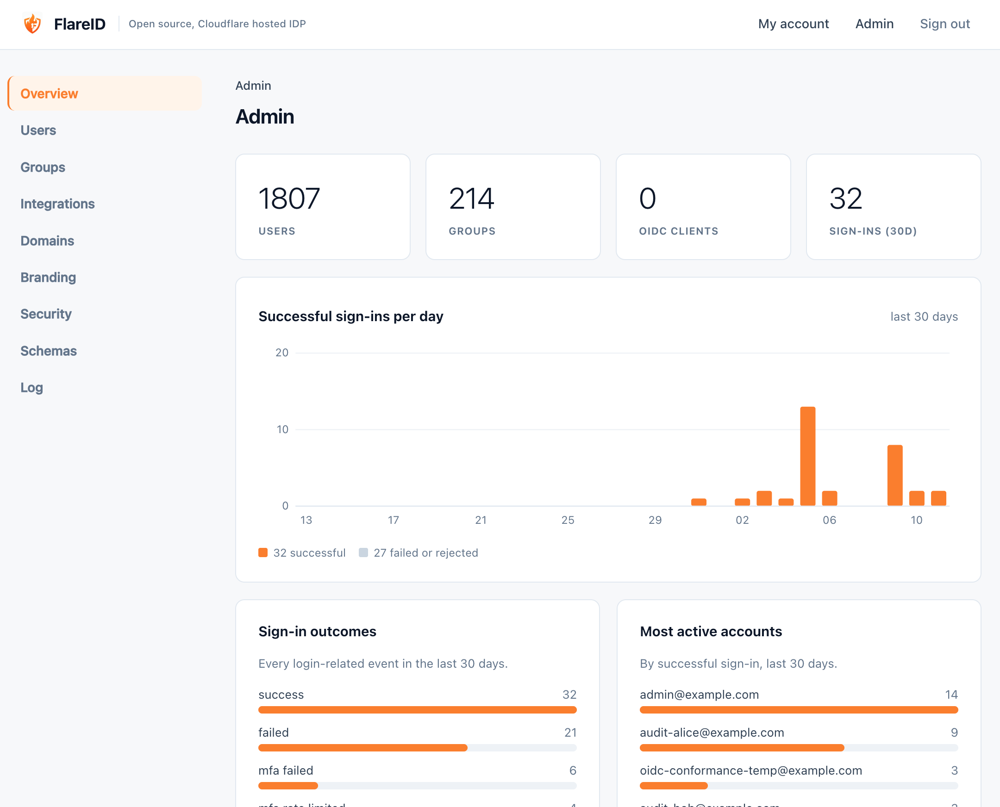

# FlareID



[](https://deploy.workers.cloudflare.com/?url=https://github.com/securitypedant/flareid)

A small, standalone OpenID Connect identity provider that runs on Cloudflare
Workers and D1. One Worker, no build step, no client-side framework: server
-rendered HTML for login, MFA, self-service and admin, plus the OIDC endpoints.

It exists because workshops and demos regularly need a real identity provider
and cannot have one - nobody is going to provision an Okta tenant for an
afternoon. It turned out to be useful beyond that, so it is being pulled out
into its own project.

**This is not an official Cloudflare product.** It is a personal project that
happens to run on Cloudflare's platform.

## What it does

- **OIDC**: `/authorize`, `/token` (authorization_code + refresh_token, PKCE),
  `/userinfo`, `/jwks.json`, `/introspect`, `/revoke`,
  `/.well-known/openid-configuration`, RP-initiated and front-channel logout.
  Confidential and public (PKCE-only) clients, a consent screen for clients not
  marked trusted, a per-client claim allowlist, and `prompt`, `max_age`,
  `auth_time`, `acr`, `at_hash`. Works with Cloudflare Access's Generic OIDC
  integration, or any standards-compliant relying party.
- **Authentication**: username (or full UPN) and password, with optional
  per-user TOTP MFA, backup codes, trusted devices, and per-group
  authentication policies - secure by default: a fresh install requires a
  second factor of everyone, administrators included, and setup or the
  policies can relax it. Email password recovery and invitations (Cloudflare Email
  Sending), session lifetime limits, and edge rate limits on every anonymous
  route. Passkeys (WebAuthn) for passwordless, multi-factor sign-in; email
  one-time codes and security questions as further second factors (off by
  default; security questions are the weakest and never count as a Super
  Admin's step-up re-authentication). New passwords are checked against
  Have I Been Pwned's breached passwords (k-anonymity, on by default), and
  Cloudflare Turnstile can guard the password sign-in and recovery forms
  against bots.
- **Directory**: users, flat groups (no nesting), multiple UPN domains, and
  HR-style attributes - job title, department, manager, employee number, hire
  date, employment status/type, location - exposed as claims so relying parties
  can write policy against them.
- **SCIM 2.0 client**: pushes users and groups to an external SCIM server, such
  as the endpoint Cloudflare Access generates for an identity provider. Scoped
  to all groups or a chosen set; deletions are queued and retried.
- **SCIM 2.0 server** at `/scim/v2`: an HR system or upstream directory can
  provision FlareID, and changes flow on to the outbound target.
- **SAML 2.0**: Web Browser SSO, service-provider-initiated, HTTP-Redirect for
  requests and HTTP-POST for responses. Signed Response and Assertion,
  transient/persistent/emailAddress NameIDs, per-SP attribute mapping, IdP
  metadata at `/saml/metadata`, encrypted assertions, Single Logout
  (`/saml/slo`), and SP metadata import. Not implemented: HTTP-Artifact binding, SOAP
  back-channel, ECP/PAOS, Name Identifier Management, Assertion Query/Request,
  embedded-signature AuthnRequests (see below).
- **Admin UX** at `/admin`: users (with CSV import), groups, OIDC clients, SAML
  service providers, API keys, SCIM, email, domains, security settings,
  branding, and a filterable audit log.
- **Branding, per domain**: an uploaded logo (PNG/JPEG, stored in D1), app
  name, sign-in message and gradient, email accent and a custom stylesheet for
  the sign-in pages - for everyone, or per UPN domain through brands chosen by
  the OIDC `login_hint`, a `?domain=` link, the hostname, and the person once
  identified (their second step, My account and every email). See
  [docs/branding.md](docs/branding.md).
- **Languages and accessibility**: the sign-in, second-step, consent,
  sign-out, recovery and setup pages in English, French and German
  (machine-assisted, review welcome), chosen by a language picker, OIDC
  `ui_locales`, `Accept-Language` or an instance default, and built to WCAG
  2.2 AA. Translations are JSON files in `locales/` - adding one is a copy and
  a pull request. See [docs/i18n.md](docs/i18n.md).
- **Self-service** at `/account`: MFA enrolment, password change, profile
  editing for the attributes the user's schema allows, active sessions and
  connected applications.
- **Provisioning API** at `/api/v1`: everything above, without a browser. See
  [docs/api.md](docs/api.md).

SAML support is the v1 profile described in
[SAML-implementation.md](SAML-implementation.md): redirect-binding AuthnRequest
receipt (signed or unsigned, verified per-SP), POST-binding Response with both
Response and Assertion signed. POSTed AuthnRequests - including Cloudflare
Access's *Signed AuthN requests*, which embed an XML signature - are
deliberately rejected, so leave `sign_request` off in Access; the reason is in
section 4 of that document.

## It starts empty, on purpose

A freshly deployed FlareID has **no users and no default password**. There is
nothing to log in as.

That is deliberate. The obvious alternative is to seed an administrator in a
migration, which means committing a password hash to a public repository, which
means every deployment that forgets to change it shares one known credential.
So instead the first administrator is created at `/setup` (or over the API),
authenticated by a `BOOTSTRAP_TOKEN` secret you set when deploying, and the
token retires itself once setup completes.

## Deploy to your Cloudflare account

1. Click **Deploy to Cloudflare** above and sign in to Cloudflare.
2. Connect GitHub or GitLab. Cloudflare copies FlareID into a new repository
   in your account, and redeploys from it on every push.
3. Choose names for the repository, the Worker, the D1 database and the KV
   namespace, or keep the defaults. They are created for you.
4. Enter the two secrets, and keep a copy of the first:
   - `BOOTSTRAP_TOKEN`: `openssl rand -hex 32`. You type it in at `/setup`.
   - `KEY_ENCRYPTION_KEY`: `openssl rand -base64 48`. It encrypts the
     signing keys. **Never change it.**

   Leave `ISSUER_URL` empty unless you want to pin the issuer.
5. **Deploy.** The build applies the D1 migrations, then deploys the Worker.
6. *(Optional, but do it now if at all.)* Add a custom domain under
   **Workers & Pages → your Worker → Settings → Domains & Routes → Add →
   Custom domain**. Do this **before** step 7: the address you complete setup
   on becomes the issuer for good, and relying parties must match it exactly.
   (To pin it instead, set the `ISSUER_URL` variable, e.g.
   `https://idp.example.com`.)
7. Open `https://<worker>.<your-subdomain>.workers.dev/setup`, or `/setup` on
   your custom domain. Enter the bootstrap token, the domain for user names
   (`example.com` makes `admin@example.com`), and the administrator's username,
   display name and password. Keep **Require a second factor for
   administrators (recommended)** ticked unless this instance should let
   administrators sign in with a password alone (you can change it later
   under **Admin → Security → Policies**).
8. Sign in at `/login`. With the box ticked, administrators must enrol a
   second factor (an authenticator app, a passkey or email codes) before going
   further.
9. Next steps, all optional:
   - **Email** (password recovery, invitations, email codes): onboard a
     sending domain with `npx wrangler email sending enable <domain>`, then set
     a From address in **Admin → Integrations → Email**. Until then, email
     features stay off.
   - **SAML**: `npm run saml:keygen` and set the `SAML_SIGNING_KEY_PKCS8` and
     `SAML_SIGNING_CERT` secrets it prints. Without them `/saml/*` answers 503.
   - **Bot protection**: Cloudflare Turnstile, in **Admin → Security**.
   - **Performance dashboard**: set the `CF_ACCOUNT_ID` variable and a
     `CF_ANALYTICS_TOKEN` secret (Account Analytics: Read).
   - **Cloudflare Access**: use FlareID as an identity provider, as described in
     [website/guides/CLOUDFLARE.md](website/guides/CLOUDFLARE.md).

### A note on `workers.dev` and Zero Trust

Some accounts have Access or Gateway protection over every `*.workers.dev`
hostname, which answers unauthenticated requests with `error code: 1050`. That
is fatal for an identity provider specifically: browsers and relying parties
have to reach it *before* they are authenticated, so it fails in the middle of
a login rather than at deploy time. Either add an Access bypass policy for the
hostname, or use a custom domain.

## Deploying from a terminal

```bash
npm install
npx wrangler login                 # or export CLOUDFLARE_API_TOKEN
npm run deploy:cli
```

That creates the D1 database and KV namespace, applies the migrations, sets the
`BOOTSTRAP_TOKEN` and `KEY_ENCRYPTION_KEY` secrets, generates the SAML signing
key and certificate (both secrets), deploys, and prints the token and where to
finish setup. **It writes to `wrangler.jsonc`** - the resource ids it created
(and a pinned issuer, when it knows one) - so expect a dirty working tree
afterwards. `npm run deploy` is just migrate-and-deploy, what Workers Builds
runs for a button deployment.

Useful environment variables:

| Variable | Effect |
|---|---|
| `CLOUDFLARE_ACCOUNT_ID` | Required if your token can see more than one account |
| `ZONE_NAME` | Puts FlareID on `idp.<ZONE_NAME>` and pins that as the issuer |
| `FLAREID_SUBDOMAIN` | Default `idp` |
| `FLAREID_ISSUER_URL` | Pin the issuer explicitly |

## First-run setup over the API

`/setup` in a browser is one way; the same thing over the API, with the same
rules:

```bash
curl -X POST https://idp.example.com/api/v1/setup \
  -H "Authorization: Bearer $BOOTSTRAP_TOKEN" \
  -H "Content-Type: application/json" \
  -d '{
        "domain": "example.com",
        "admin": { "username": "admin" },
        "complete": true
      }'
```

The response carries the generated administrator password. Sign in at `/login`
and go to `/admin`.

**The issuer.** With `ISSUER_URL` empty, FlareID answers as whatever https
address a request arrived on until setup completes, then stores the address
setup was completed on and keeps it, whatever hostname later requests use.
Plain http is refused except on `localhost`. A non-empty `ISSUER_URL` always
wins.

For anything ongoing - CI, Terraform, a provisioning script - mint an API key
from **Admin → Integrations** instead; the bootstrap token only answers the
documented break-glass route once setup is complete.

## Local development

```bash
npm install
cp .dev.vars.example .dev.vars     # then replace both values
npm run db:migrations:local
npm run dev                        # http://localhost:8790
```

Then open `http://localhost:8790/setup`, or run the setup call above against
it.

### Workers plan

Passwords are hashed with scrypt, which takes about 100 ms of CPU per sign-in -
fine on Workers Paid, but beyond the Free plan's 10 ms CPU limit. On the Free
plan set the `PASSWORD_HASHER` var to `pbkdf2` (PBKDF2-SHA256 at the platform's
100,000-iteration ceiling). Existing hashes of either kind keep verifying
whichever is set.

The Worker also runs an hourly Cron Trigger that deletes expired codes, tokens,
sessions and remembered devices, and audit entries past the retention set in
Admin → Security.

## Tests

```bash
npm test          # crypto, OIDC and SAML flows, the provisioning API, first-run setup, security
npm run typecheck
```

The suite runs inside the Workers runtime via `@cloudflare/vitest-plugin`,
against a local D1 migrated from the real migration files - so the schema under
test is the schema that ships. CI runs both plus a `wrangler deploy --dry-run`.

## Architecture

| Piece | Where |
|---|---|
| Users, groups, membership, domains | D1: `users`, `groups`, `group_members`, `domains` |
| Registered relying parties | D1: `oauth_clients` |
| Authorization codes, access and refresh tokens | D1: `auth_codes`, `access_tokens`, `refresh_tokens` |
| Sessions, trusted devices, backup codes | D1: `sessions`, `trusted_devices`, `mfa_backup_codes` |
| Provisioning API keys | D1: `api_keys` (SHA-256 hashes only) |
| Settings, audit log | D1: `idp_settings`, `audit_log` |
| Short-lived login-flow and pending-MFA state, rate limits | KV: `SESSIONS_KV` |
| `id_token` signing | RS256 and ES256 via `jose`; keys generated in D1 (`signing_keys`), encrypted with `KEY_ENCRYPTION_KEY`, rotated from Admin → Security |
| Password hashing | PBKDF2-SHA256 via Web Crypto, iteration count stored per row |
| TOTP | RFC 6238 by hand (HMAC-SHA1, 6 digits, 30s), authenticator-app compatible |

## Wiring into Cloudflare Access (Generic OIDC)

1. In FlareID, **Admin → Integrations → + New client**. Give it a name and the
   redirect URI Access will call back to - something like
   `https://<your-team>.cloudflareaccess.com/cdn-cgi/access/callback`. Copy the
   client id and the secret, which is shown once.
2. In [Cloudflare Zero Trust](https://one.dash.cloudflare.com) →
   **Integrations** → **Identity providers** → **Add new** → **OpenID
   Connect**, fill in:
   - **App ID**: the client id
   - **Client secret**: the secret
   - **Auth URL**: `https://<flareid-host>/authorize`
   - **Token URL**: `https://<flareid-host>/token`
   - **Certificate URL**: `https://<flareid-host>/jwks.json`
   - **Scopes**: `openid email profile groups`
   - Optional claims: `groups`
3. Save, then add it to your Access applications.

Access policies can then match on `email` or on the `groups` claim directly.
Enabling SCIM on the identity provider and configuring the endpoint and secret
under **Admin → Integrations** makes group names appear in the policy builder,
but is not required for group matching to work.

The whole of this can be done over the API instead - see
[docs/api.md](docs/api.md).

## Roadmap

[ROADMAP.md](ROADMAP.md) is honest about what this is: a functional identity
provider with a list of things that have to be true before it should be pointed
at anything that matters. The current head of that list is that there was no
test suite at all until recently, and that CSRF defence, security headers and a
stronger password KDF are still outstanding.
